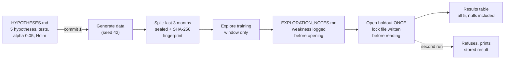
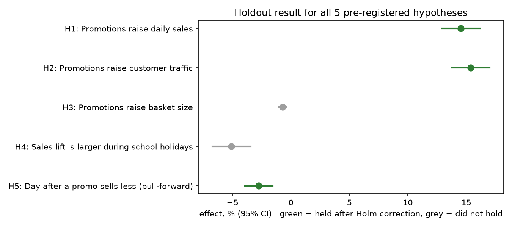

# retail-promo-preregistered

**What does a store promotion actually do?** Five hypotheses, written down and committed
before the data existed, tested once on a sealed 3-month holdout, with a correction for
running five tests. Every result is reported, including the ones that failed.

> **Honest status: this run uses synthetic data.** The data comes from a seeded
> generator in this repo (`src/generate_data.py`) that copies the layout of the public
> Rossmann Store Sales dataset. Because I wrote the generator, I know the true effects,
> so this run shows the method finds what is there and rejects what is not. It says
> nothing about real shoppers. Swapping in the real Rossmann file is a config change
> (see "What next").

## The problem

A retail chain runs promotions in alternating weeks. A manager wants five answers, not
one: does a promo raise sales, does it bring in more people or bigger baskets, does it
work better during school holidays, and does it just borrow sales from the next day?

The trap in this kind of question is testing many ideas, keeping the ones that look good
and quietly dropping the rest. This project removes that option by fixing the plan first.

## How the order is proven



Run `git log --reverse --oneline` to see it: the plan is the first commit, and the
holdout script was committed before it ran. `results/holdout_opened_*.json` records when
the holdout was opened, its fingerprint, and the commit of the plan in force at the time.

## Data

| | |
|---|---|
| Source | Synthetic, `src/generate_data.py`, seed 42 |
| Layout | Rossmann Store Sales columns: Store, Date, Sales, Customers, Open, Promo, SchoolHoliday |
| Size | 60 stores, 2024-01-01 to 2026-06-30, 54,720 store-days |
| Training window | 2024-01-01 to 2026-03-31 |
| Sealed holdout | 2026-04-01 to 2026-06-30 (last 3 calendar months) |
| Planted truth | promo raises customers about 16%, basket about -1%, no school-holiday interaction, about -3% on the day after a promo |

## Approach

1. **Baseline per store and weekday**, from non-promo training days. Each holdout day
   becomes "how far above or below this store's normal Tuesday" on a log scale. That
   takes out store size and the weekday pattern.
2. **One number per store per test.** Days inside one store are not independent, so the
   store is the unit (60 stores, not 5,000 days).
3. **One-sided t-test across stores** in the direction the plan states, with a Wilcoxon
   signed-rank check alongside.
4. **Holm-Bonferroni** across all 5 p-values, family-wise alpha 0.05.

## Results (synthetic run, holdout opened once on 2026-10-20)

**3 of 5 held, 2 did not.**

| # | Hypothesis | Effect | 95% CI | Holm p | Verdict |
|---|---|---|---|---|---|
| H1 | Promotions raise daily sales | +14.5% | +12.9% to +16.2% | 5.8e-27 | held |
| H2 | Promotions raise customer traffic | +15.4% | +13.8% to +17.0% | 6.0e-28 | held |
| H3 | Promotions raise basket size | -0.7% | -1.0% to -0.4% | 1 | did not hold |
| H4 | Sales lift is larger during school holidays | -5.1% | -6.7% to -3.4% | 1 | did not hold |
| H5 | Day after a promo sells less | -2.7% | -3.9% to -1.6% | 3.3e-05 | held |

Full table with store counts and Wilcoxon checks: `results/RESULTS.md`.



**What it means for the business (in this synthetic world):** the promotion works by
bringing more people in, not by making baskets bigger (baskets actually shrink a little,
which fits discounting). Some of the lift is borrowed from the next day: the first open day after a promo (nearly always the
Saturday) sells 2.7% less than other non-promo days, after adjusting for weekday. Against five promo days at +14.5%
each, that is a small give-back, but it is real and the promo-day number alone overstates
the gain.

**What it shows about the method:** all 5 verdicts match the planted truth. But H4 is a
warning. Its estimate is clearly negative (-5.1%) when the true interaction is zero. That
bias was spotted in the training window and written down in `EXPLORATION_NOTES.md`
**before** the holdout was opened: the baseline removes weekday but not season, and the
school-holiday promo and non-promo days fall in different weeks. The verdict was right
only because the test was one-sided. A two-sided test would have "found" a false effect.

Charts: `results/charts/` (training sales with the holdout left blank, promo lift by
weekday, holdout effects, per-store spread).

## Run it

```bash
python run_all.py
```

Uses Python with pandas, NumPy, SciPy, matplotlib and PyYAML. The first run builds the
data, splits it, explores training, opens the holdout and runs the notebook. Every run
after that refuses to reopen the holdout and prints the stored result.

**To use a different dataset:** in `config.yaml` set `source: csv`, point `path` at the
file and map the column names. No code changes.

## What next

1. **Run it on real data.** Rossmann Store Sales has the same columns, so it is a config
   change. That is the step that makes this a real finding.
2. **Fix the H4 design** in a new pre-registration: compare promo and non-promo days
   inside the same weeks, or add week of year to the baseline.
3. **Price the pull-forward:** turn H1 and H5 into net extra sales per promo week.

## Files

| File | What it does |
|---|---|
| `HYPOTHESES.md` | the plan, committed first |
| `EXPLORATION_NOTES.md` | what training showed, written before opening |
| `config.yaml` | dataset, column names, holdout length, alpha |
| `src/generate_data.py` | seeded synthetic data with documented planted effects |
| `src/prepare.py` | split, fingerprint and seal |
| `src/features.py` | cleaning, baseline, deviations, day-after flag |
| `src/hypothesis_tests.py` | the 5 tests and Holm correction |
| `src/explore_train.py` | training-only charts and dry run |
| `src/confirm_holdout.py` | opens the holdout once |
| `notebooks/walkthrough.ipynb` | reads results only, never reopens the holdout |
